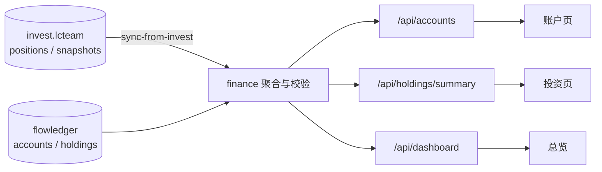
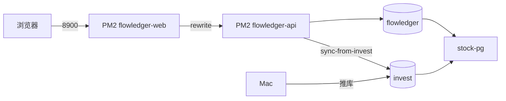

# FlowLedger 架构文档

## 概述

FlowLedger 是本地优先的个人财务管理系统，数据存储在 PostgreSQL，通过 FastAPI 统一 API 为 Web 和 CLI 提供服务。

## 技术栈

- **Web**: Next.js 15 + TypeScript + Tailwind CSS
- **API**: FastAPI + Pydantic + SQLAlchemy
- **数据库**: PostgreSQL（本地安装，默认 localhost:5432）
- **迁移**: Alembic
- **CLI**: Python Typer

## 数据模型

核心表：`accounts`, `categories`, `transactions`, `budgets`, `holdings`

扩展表：`liabilities`, `recurring_bills`, `rules`, `goals`, `import_jobs`

### 总览支出口径

- **本月支出** = 当月 `transactions(type=expense)` 合计 + **本月到期且尚未落账**的 `recurring_bills`
- 定期账单默认只作提醒；调用 `POST /api/recurring-bills/materialize` 后写入流水（默认不改账户余额）
- 落账去重：同月同账户、同金额、同商户名视为已存在，避免与手动记账重复
- 现金流、趋势图（当前月）、月报与总览同口径

### 投资账户语义

- `accounts.type` 为 `broker` / `fund` 时，`balance` = **账户总资产**（闲置现金 + 持仓市值）
- `holdings` 为该账户下的证券明细；市值之和不得超过账户余额
- 净资产 = Σ账户余额 − 未在账户中体现的负债（**不再叠加** holdings）
- 信用卡若同时以 `accounts(type=credit)` 负余额与 `liabilities` 记录，计算净资产时去重
- 持仓增删改价会按市值差额回写投资账户 `balance`（闲置现金相对不变）

### 投资数据链路



权威源：`invest.lcteam.position_snapshots` + `positions(account_type=real)`。  
同步命令：`./scripts/sync-invest.sh` 或 `POST /api/holdings/sync-from-invest`。

## API 端点

| 端点 | 说明 |
|------|------|
| GET /health | 健康检查 |
| GET /api/dashboard | 总览聚合 |
| CRUD /api/accounts | 账户（投资账户含 holdings_mv/cash 拆分） |
| GET /api/accounts/net-worth | 净资产（与 Dashboard 同口径） |
| CRUD /api/transactions | 流水 |
| GET /api/transactions/transfers | 转账配对明细（转出→转入） |
| CRUD /api/budgets | 预算 |
| CRUD /api/holdings | 持仓 |
| GET /api/holdings/summary | 投资组合（含现金拆分） |
| GET /api/holdings/daily-pnl | 指定月每日收益波动（invest snapshots） |
| GET /api/holdings/validate | 投资账户与持仓一致性校验 |
| POST /api/holdings/sync-from-invest | 从 invest.lcteam 同步真实持仓 |
| CRUD /api/liabilities | 负债 |
| CRUD /api/goals | 财务目标 |
| GET/POST /api/recurring-bills | 定期账单 |
| POST /api/recurring-bills/materialize | 将指定月定期账单落成支出流水（默认不改余额） |
| CRUD /api/rules | 自动分类规则 |
| POST /api/import/csv | 账单导入 |
| GET /api/reports/monthly | 月报 |
| GET /api/reports/cashflow | 现金流预测 |

## CLI 命令

```bash
finance today
finance add expense --amount 68 --category 餐饮 --note 午餐
finance import csv file.csv --source alipay
finance budget status --month 2026-07
finance portfolio summary --as-of today
finance export report --format xlsx --month 2026-07
```

## 启动（本地优先）

**前置条件**：本地 PostgreSQL 已安装并运行。

```bash
# macOS 示例
brew install postgresql@15
brew services start postgresql@15

# 初始化项目
cp .env.example .env
chmod +x scripts/*.sh
./scripts/install-autostart.sh   # 登录自启 + KeepAlive（推荐）
./scripts/start.sh               # 拉起服务（已装 LaunchAgent 则走 launchd）
./scripts/verify.sh
./scripts/stop.sh                # 停止（会 bootout KeepAlive，避免立刻被拉起）
```

macOS 启动项为 `com.flowledger.api` / `com.flowledger.web`（`KeepAlive`）。旧版 oneshot `com.flowledger.start` 已废弃，安装脚本会自动卸载。

`start.sh` 默认连接 `postgresql://localhost:5432/flowledger`。若库不存在，会尝试用 `postgres` 超级用户自动创建。

可选 Docker 回退：`USE_DOCKER_PG=1 ./scripts/start.sh`

## 备份

```bash
./scripts/backup.sh
```

## 混合部署（阿里云 · 共用 stock-pg）

Web/API 跑在 ECS；数据库复用 stock 的 Docker PG（`stock-pg` · `127.0.0.1:5432`），同实例新建 `flowledger` 库，只读同机 `invest` 做持仓同步。invest 真源仍由 Mac 经 stock 推送。



```bash
# 一键部署
bash scripts/deploy/deploy-aliyun.sh

# Mac 推业务库到云
bash scripts/deploy/push-db-to-cloud.sh
```

运维台账见 [云端运维.md](./云端运维.md)。
